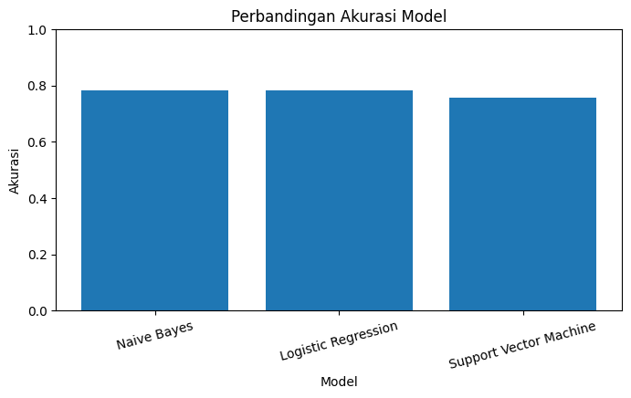
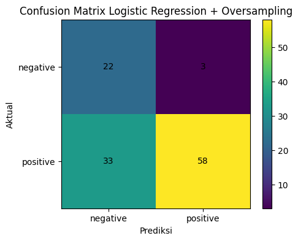
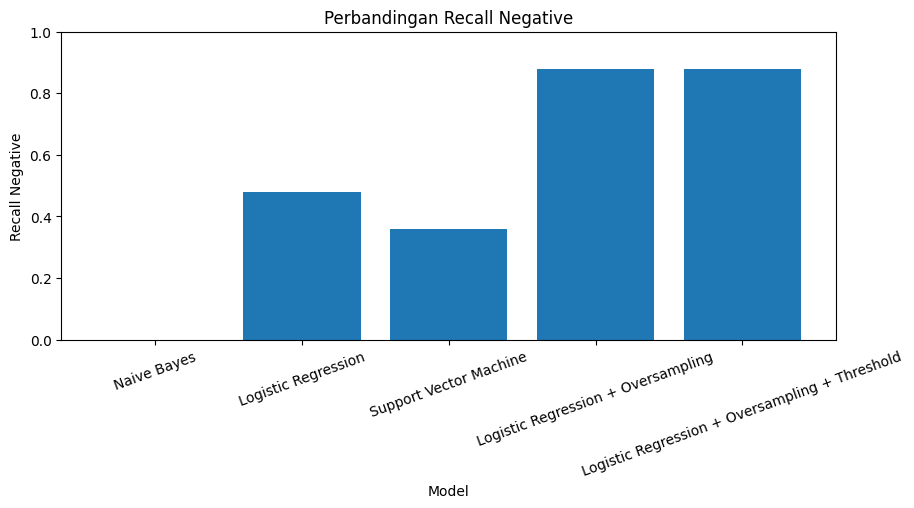

# Sentiment Analysis of Restaurant Reviews: Api Api Ikan Bakar

Sentiment classification (positive / negative) of Google Maps customer reviews for **Restoran Api Api Ikan Bakar** (Perlis, Malaysia), built with TF-IDF features and classic machine-learning models in Python.

Final project for the *Artificial Intelligence Theory* course, Informatics Engineering Education, Universitas Negeri Yogyakarta (2026).



## Overview

| Item | Detail |
|---|---|
| Dataset | Perlis Malaysia Restaurant Reviews with Sentiment Score (29,652 reviews, 18 columns) |
| Subset used | Restoran Api Api Ikan Bakar: 580 labelled reviews (456 positive, 124 negative) |
| Features | TF-IDF, 1–3 word n-grams (max 5,000 features), custom stopwords that keep negations (*not*, *no*, *never*) |
| Split | 80 / 20 stratified (464 training, 116 testing), `random_state=42` |
| Models | Multinomial Naive Bayes, Logistic Regression, Linear SVM (both with balanced class weights) |
| Imbalance handling | Random oversampling of the negative class, extra class weight on negatives, decision-threshold tuning |

## Workflow

1. Load the dataset and filter reviews for Restoran Api Api Ikan Bakar
2. Select the relevant columns and drop rows without text or label
3. Exploratory analysis: sentiment and rating distribution, sample reviews
4. Text preprocessing: lowercasing, keeping only letters, normalising whitespace
5. TF-IDF feature extraction and train/test split
6. Train and compare Naive Bayes, Logistic Regression and SVM
7. Handle class imbalance with oversampling and tune the negative-class threshold
8. Predict the sentiment of new reviews (demo)
9. Find the most frequent words and phrases (unigrams and bigrams) in positive and negative reviews

## Results

| Model | Accuracy | Recall (negative) | F1 (negative) | Macro F1 |
|---|---|---|---|---|
| Naive Bayes | 0.78 | 0.00 | 0.00 | 0.44 |
| Logistic Regression | 0.78 | 0.48 | 0.49 | **0.68** |
| Support Vector Machine | 0.76 | 0.36 | 0.39 | 0.62 |
| Logistic Regression + Oversampling (+ threshold) | 0.69 | **0.88** | **0.55** | 0.66 |

Naive Bayes reaches the same accuracy as Logistic Regression only because it predicts every review as positive. Oversampling lowers overall accuracy, but the model then finds **88% of negative reviews** (up from 48%). That matters more if the restaurant wants to act on complaints.

<p>
  
  
</p>

## Project structure

```
├── data/
│   └── perlis_reviews.csv                 # raw dataset
├── notebook/
│   └── analisis_sentimen_api_api.ipynb    # full analysis (Indonesian)
├── output/                                # charts and result tables produced by the notebook
├── requirements.txt
└── README.md
```

## How to run

```bash
python -m venv venv
venv\Scripts\activate          # Windows  (macOS/Linux: source venv/bin/activate)
pip install -r requirements.txt
jupyter notebook notebook/analisis_sentimen_api_api.ipynb
```

Run all cells from the top. The notebook reads `../data/perlis_reviews.csv` and writes its charts and tables to `../output/`.

## Tech stack

Python · pandas · NumPy · scikit-learn · Matplotlib · Jupyter Notebook

## Author

**Fierlansyah Krishna Desfarro**: [github.com/FFFzensky](https://github.com/FFFzensky)
